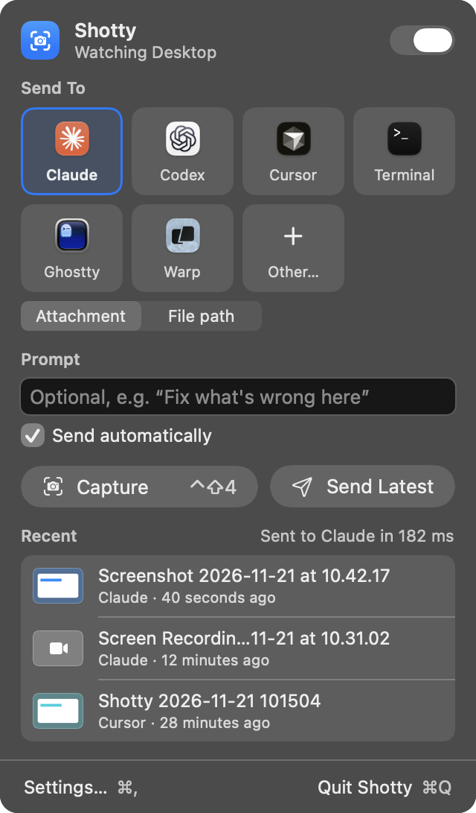
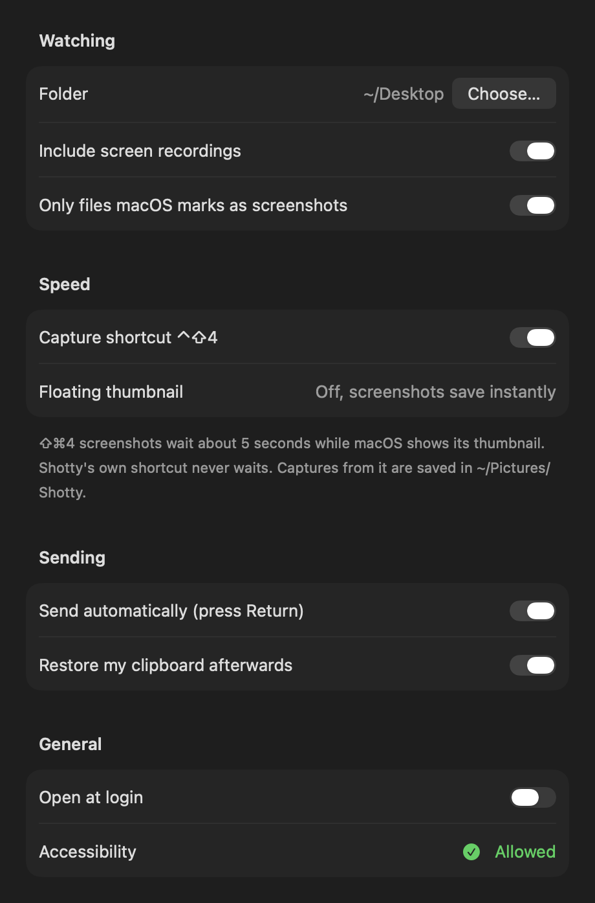

<h1 align="center">Shotty</h1>

<p align="center"><b>Screenshot → your AI agent, instantly.</b><br>
A tiny macOS menu bar app that drops every new screenshot or screen recording straight into Claude, Claude Code, Codex, Cursor or any app you choose.</p>

<p align="center">
  
  &nbsp;&nbsp;
  
</p>

## Why

Showing an agent what you see usually takes five steps: screenshot, find the file, switch apps, drag it in, type a question. Shotty does it in one. Take the shot and it's already in the chat, with your prompt if you want one.

## Features

- **Instant capture**: press **⌃⇧4**, select an area (or Space for a window), and it's pasted the moment you let go.
- **Works with normal screenshots too**: ⇧⌘3, ⇧⌘4 and ⇧⌘5 recordings are picked up from your screenshot folder.
- **Pick the destination in one click**: Claude, Codex, ChatGPT, Cursor, Terminal, Ghostty, iTerm, Warp, or any other app.
- **Two paste modes**: *Attachment* pastes the image itself (chat apps). *File path* pastes the path, which is what Claude Code and Codex CLI read in a terminal.
- **Optional prompt** pasted with the shot, and optional **send automatically** (presses Return).
- **Leaves your clipboard alone**: what you had copied is restored after the paste.
- Native SwiftUI with the standard macOS translucent materials. No account, no network, no tracking.

## Install

### Download

Grab `Shotty.zip` from the [latest release](https://github.com/remidiy/Shotty/releases/latest), unzip, and move **Shotty.app** to Applications.

### Homebrew

```bash
brew install --cask remidiy/tap/shotty
```

(Available once the first notarized release is out; see [docs/RELEASING.md](docs/RELEASING.md).)

### Build from source

Needs macOS 26 or later and Xcode 26 or later.

```bash
git clone https://github.com/remidiy/Shotty.git
cd Shotty
./scripts/build-app.sh
open dist/Shotty.app
```

## First run

Shotty lives in the menu bar (camera icon). macOS will ask for:

| Permission | Why |
| --- | --- |
| **Accessibility** | To press ⌘V (and Return) in the app you picked |
| **Screen Recording** | Only for Shotty's own ⌃⇧4 capture |
| **Desktop / folder access** | To notice new files in your screenshot folder |

## Why normal screenshots can feel slow

By default macOS shows a floating thumbnail for about 5 seconds after ⇧⌘4 and only writes the file when it disappears. Nothing can send it before then. Fix it either way:

- Use Shotty's **⌃⇧4** shortcut, which never shows the thumbnail, or
- Click **Make Instant** in Shotty (or untick *Show Floating Thumbnail* in the ⇧⌘5 Options menu).

After that, Shotty usually pastes in well under half a second. It shows the time for each send.

## Could Shortcuts or Folder Actions do this?

Mostly, with glue. On macOS 26, Shortcuts automations can trigger when a file is added to a folder, and so can Folder Actions. The paste itself still needs a "Run AppleScript" step sending keystrokes. You'd also have to handle partly written recordings, separate logic for chat apps vs terminals, switching targets by editing the shortcut, and losing your clipboard. Shotty packages all of that.

## Develop

```bash
swift build                                       # debug build
dist/Shotty.app/Contents/MacOS/Shotty --demo      # preview the UI with sample data, sends nothing
```

| File | What it does |
| --- | --- |
| `FolderWatcher.swift` | Notices new captures and waits until they're fully written |
| `InstantCapture.swift` | The ⌃⇧4 shortcut and `screencapture` call |
| `Sender.swift` | Brings the target app forward and pastes |
| `AppModel.swift` | Settings and state |
| `MenuView.swift`, `SettingsView.swift` | The UI |

Releasing, signing and notarization: [docs/RELEASING.md](docs/RELEASING.md). Contributions: [CONTRIBUTING.md](CONTRIBUTING.md).

## License

MIT
